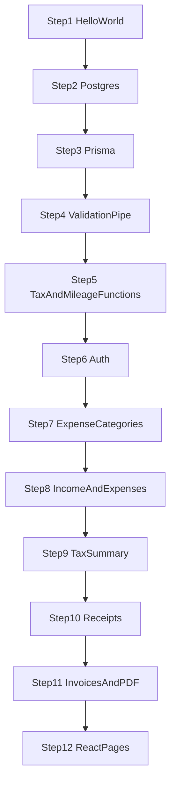

# TheraTax project plan

This file is the map of the build. Each step lives in its own file. Open one step at a time. A step is done only when its check command or Postman request matches the written result. The lesson teaches the build order. It does not change the app by itself.

The sequence starts from the Nest app that answers `Hello World!` on port 3000, Postgres in [`docker-compose.yml`](../docker-compose.yml), and the API contract in [`api-spec.md`](api-spec.md). The five user-facing screens are in [`01_user_flow.md`](01_user_flow.md).

## The sequence



This is the only order that works. [Step 6](08_step06_register_login_onboarding.md) is the first step with a real product endpoint. Calling `PATCH /users/me/onboarding` before that step is not work for the step you have open. A call without the header `Authorization: Bearer <token>` gets `401` and the message `Unauthorized`. That means the request has no user identity. It does not mean onboarding is broken, and it is not a reason to skip ahead and write another endpoint.

1. [Understand the running app](03_step01_understand_the_running_app.md). Confirm Nest answers `Hello World!` on port 3000.
2. [Open the database](04_step02_open_the_database.md). Start Postgres and point `.env` at it. No tables yet.
3. [Add Prisma](05_step03_add_prisma.md). Connect the app to Postgres and create the tables. `GET /` is still `Hello World!`.
4. [Enable ValidationPipe](06_step04_enable_validation_pipe.md). Prove unknown fields are rejected, then delete the temporary probe.
5. [Tax calculator](07_step05_tax_calculator.md). Lock tax and mileage figures in unit tests. No HTTP route yet.
6. [Register, login, onboarding](08_step06_register_login_onboarding.md). Add the first product endpoints and a bearer token.
7. [Expense categories](09_step07_expense_categories.md). Seed eight categories and return them in a fixed order.
8. [Log income and expenses](10_step08_log_income_and_expenses.md). Record one transaction per request, including mileage amounts.
9. [Tax summary](11_step09_tax_summary.md). Load the year's totals and call the tax function.
10. [Receipt images](12_step10_receipt_images.md). Attach one image to a transaction and hand out a 15-minute link.
11. [Invoices and PDF](13_step11_invoices_and_pdf.md). Issue a one-line invoice, download a PDF, and record income only when it is paid.
12. [React pages](14_step12_react_pages.md). Build the screens in [`01_user_flow.md`](01_user_flow.md), one page at a time.

## Gate rule

Finish the step you have open, until the check command matches what that file says, before you open the next step.

"Checkable" means a command or a Postman request that you send and see with your own eyes. A file existing is not enough. If there is no check command or request yet, the step is not done, and you do not open the next step's file.

Each step owns only its own files. Every step ends with **Pass this step, then continue**. If the result does not match, stop at that step's "If it fails" section.

## What is already in the repo

The working tree already has drafts that jumped ahead of this sequence: Prisma, `ValidationPipe`, the tax functions, and auth. Those files are drafts to compare against each step's checks. They are not the start of the lesson.

During step 1, if `npm test` fails because of a test in a later step's file, do not go and fix that file. The check for step 1 is the browser and Postman only.

## Contract the whole lesson follows

Money is an integer number of pence. £20 is `2000` pence. £20,000 is `2_000_000` pence. Decimal numbers make the total ambiguous when it has to be rounded to pence.

Civil dates (`occurredOn`, `issuedOn`, `paidOn`, and the tax-year bounds) are `DD-MM-YYYY` strings. Clock timestamps (`onboardedAt`, `expiresAt`) are ISO 8601. "Today" and the start of the tax year use the calendar date in the `Europe/London` zone. The UK tax year turns on 6 April. A UTC date picks the wrong day around midnight.

`taxYear=2026` means 6 April 2026 through 5 April 2027. This contract supports only that year. Any other year returns `400`. A date outside this window returns `400` with the message `Date is outside the 2026-27 tax year`.

Responses are JSON of number, string, array, or object. Do not send a `Date` or a `Decimal`.

Errors the user sees must be Nest `HttpException`s (`BadRequestException`, `UnauthorizedException`, `ForbiddenException`, `NotFoundException`, `ConflictException`). There are two shapes, and the client must accept both.

- The pipe rejects the body: `message` is an array of strings.
- Code rejects on purpose: `message` is a single string.

A boot error, such as a missing `DATABASE_URL`, may throw `Error`, because there is no client to answer yet.

## Code rules for every step

- NestJS 12 is an ES module (`"type": "module"`) on TypeScript strict and Node.js 24.
- Imports of project files always end in `.js`, even though the file on disk is `.ts`, because ESM Node loads the compiled file.
- An HTTP body must be a class with `class-validator`. Do not use an interface as a body.
- In a controller, import the DTO class as a value. `import type` erases the class at runtime, and `ValidationPipe` will not check the fields.
- In a service whose method has no decorator, use `import type` for a type that appears in the signature.
- A parameter with a decorator must always declare a type.
- No `any`. Do not use `as` to silence a type error. No `!`.
- File names are `kebab-case.<role>.ts`, for example `create-transaction.dto.ts`.
- One domain is one folder under `src/`: `auth`, `transactions`, `tax-engine`, `expense-categories`, `upload`, `invoices`. Inside are `*.module.ts`, `*.controller.ts`, `*.service.ts`, and `dto/`. The `/users/me` routes live in `auth`.
- `src/prisma/` holds a global `PrismaModule` and the only `PrismaService` that may construct `PrismaClient`.
- `src/generated/prisma/` is code Prisma generates. Do not edit it by hand.
- Do not create an `index.ts` to re-export.
- Do not write a comment that only narrates the next line.
- The calculator is a pure function with unit tests. A handler loads data and calls the function. Do not put the formula in a controller.
- Install an extra package only when that step says to, and install it yourself. Run `docker` and `prisma migrate` / `prisma generate` yourself, on the step that writes those commands.
- Phase 2 at the end of [`api-spec.md`](api-spec.md) is outside this lesson: multi-line invoices, VAT, Scottish tax, motorcycle mileage, changing `expenseMethod` after onboarding, categories the user creates, and any tax year other than 2026–27.

Paths have no `/api` prefix. Every path matches the contract table. The API port is `3000`.

## Check HTTP with Postman

Every HTTP request in this lesson is sent from Postman. The terminal commands you still run yourself are `npm`, `docker compose`, `prisma`, and `psql`.

Create an environment named `local`. Set the variable `baseUrl` to `http://localhost:3000`, and select this environment before every Send. URLs in the lesson are written as `{{baseUrl}}/...`.

For a JSON request, open Body, choose raw, then choose JSON. You do not type the `Content-Type` header yourself.

For a request that must know who the user is, open the Authorization tab, choose Type Bearer Token, and put that user's variable name, for example `{{token}}`. Postman sends the header `Authorization: Bearer <value>`. There is one space after the word Bearer.

After register or login, store `accessToken` on the environment from that request's Tests tab.

```js
pm.environment.set('token', pm.response.json().accessToken);
```

A step whose user is not the first one will tell you to change the variable name to `bee` or `cai`. Copying `accessToken` from the Body into an environment variable works the same way.

Read the status on the response, and read the Body against that step's check. Response headers are on the Headers tab.

## When all twelve steps are done

The layout that appears, in order, is this.

```text
prisma/schema.prisma
prisma.config.ts
src/main.ts
src/app.module.ts
src/prisma/
src/tax-engine/          tax, mileage, and date functions, and GET /tax/summary
src/auth/                register, login, current user, onboarding
src/expense-categories/  eight categories
src/transactions/        income and expense feed
src/upload/              receipt images and 15-minute links
src/invoices/            invoices and PDF
client/                  React pages for the user flow
```

Outside the lesson is Phase 2 in [`api-spec.md`](api-spec.md): no multi-line invoices, no VAT, no Scottish tax, no motorcycle mileage, no change of `expenseMethod` after onboarding, and no tax year other than 2026–27.

A step is finished only when that step's check command produces the result written in its file.
