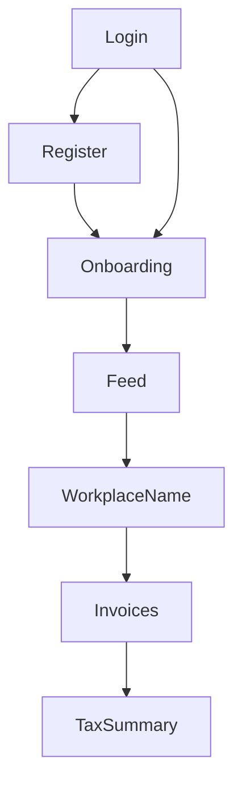

# TheraTax page plans

This file is the map of the React screens. Each page lives in its own file. Open one page file for fields, validation, and acceptance checks. This file does not change the app by itself.

The screens follow [`01_user_flow.md`](01_user_flow.md). The build order is [`02_project_plans.md`](02_project_plans.md). [Step 12](14_step12_react_pages.md) is how the baseline pages were created. It is not this index. The HTTP contract is [`api-spec.md`](api-spec.md).

## The screens

There is no income route. Workplace name is [24](24_page_directory.md) at `/workplaces`, so the invoice plan stays 25. Choosing a workplace, massage income, the bonus, and the daily summary are parts of the feed. Saving a workplace or a client name is the Workplace name page. The invoice page can still save a name while issuing a bill. Recipient and period choice are parts of the invoice page.

1. [Login](21_page_login.md). Email and password at `/`. Stores the bearer token and opens onboarding or the feed.
2. [Register](22_page_register.md). Name, email, and password at `/register`. Same door as login after `201`.
3. [Feed](23_page_feed.md). Log income or an expense, attach a photo when there is one, and show the daily income summary.
4. [Workplace name](24_page_directory.md). Save a spa, a clinic, or a client name at `/workplaces`.
5. [Invoice](25_page_invoice.md). Bill a saved spa, clinic, or client for a day or a month, then download the PDF.
6. [Onboarding](26_page_onboarding.md). One-time practice type and vehicle method. No route of its own.
7. [Tax summary](27_page_tax_summary.md). Show `GET /tax/summary` for the signed-in user.

## How the user moves

A visitor with no token sees login. Register is a link, not a second form on the login page. After register or login the client stores `accessToken` and calls `GET /users/me`.

If `onboardedAt` is `null`, the only screen is onboarding. The feed, workplace names, invoices, and the tax summary are not in the menu yet. After onboarding, the feed is `/`. Workplace name is `/workplaces`. Invoices are `/invoices`. The tax summary is `/tax`. Log out clears the token and returns to `/`.

A `401` while a token is stored deletes the token and returns to login. That is an expired or unknown session. It is not the same message as a wrong password.

## Shared pieces

These files serve more than one page. A page plan names the ones it uses.

- `client/src/api.ts` reads `accessToken` from `localStorage`, sends `Authorization: Bearer`, and turns `message` into text. An array is joined. A string is shown as it is. Register and login do not send a token.
- `client/src/format.ts` turns pence into pounds, reads whole pounds and pence from 0 to 99 as an integer, and turns a date input into `DD-MM-YYYY`.
- `client/src/FormError.tsx` shows the text from a failed request.
- `client/src/hint.ts` and `client/src/category-filter.ts` suggest an expense category in the browser. There is no hint endpoint.
- `client/src/App.tsx` holds the session and the menu. Login and register are the only routes while signed out. Onboarding replaces the menu. The menu after onboarding is Feed, Workplace name, Invoices, and Tax summary.
- `client/src/directory-forms.tsx` saves a workplace or a client. Workplace name and the invoice page both use it. The feed does not.

Money on the screen is pounds. The API stores integer pence. £20 is `2000`. Two fields, whole pounds and pence from 0 to 99, become pence by integer arithmetic. Do not use `Number("65.10") * 100`.

Civil dates are `DD-MM-YYYY`. A blank date on a create is today in `Europe/London`. Clock times such as `onboardedAt` are ISO 8601. The tax year on these pages is 6 April 2026 through 5 April 2027.

## Rules that cross pages

- The feed lists Income before Expense wherever both appear together, including the type choice and the rows for one day.
- Massage income is base plus the additional fee plus the bonus. The screen labels are Base Massage Income, Additional Massage Fee, and Bonus. The API fields are `basePence`, `additionalFeePence`, and `bonusPence`.
- Bonus is an amount the user types for that income row. It is not hours, minutes, or a rate. Empty and £0 add nothing.
- The daily summary, the tax summary, and an invoice each include that bonus once. They do not add `amountPence` on top of the three parts, and they do not add the bonus again beside `amountPence`.
- Massage Type includes Body Scrub (`body_scrub`). Other asks for a custom name.
- A workplace or a client is saved once and reused by id. An income row does not create a second copy of the name.
- Saving income or an expense does not require a photo. The photo is a later request on that row.
- A new invoice is a snapshot of matching income rows. Creating it or marking it paid does not insert another income row.

## Status

Login, register, onboarding, the feed, invoices, and the tax summary exist as baseline screens. The feed logs one amount or an expense and can attach a photo. The invoice page still sends a one-line body. Those baseline checks are [step 12](14_step12_react_pages.md).

Massage fields, the workplace picker, the bonus, the daily summary, and recipient or period choice are specified in the page plans. They are not on the React pages yet. Build them when the matching API step is the one you have open. Do not add them during step 12.

The source tree already contains workplaces, massage income, clients, the daily summary, and invoices from records. It also contains `src/hourly-bonuses` and an `HourlyBonus` model from the previous contract. That module is not the rule in these page plans. Do not extend it. `body_scrub` and `bonusPence` are not in the running source yet. This map does not change that code.

## What these files do not own

HTTP shapes, status codes, and the pure functions stay in the step files and in [`api-spec.md`](api-spec.md). A page plan cites them. It does not keep a second formula.
